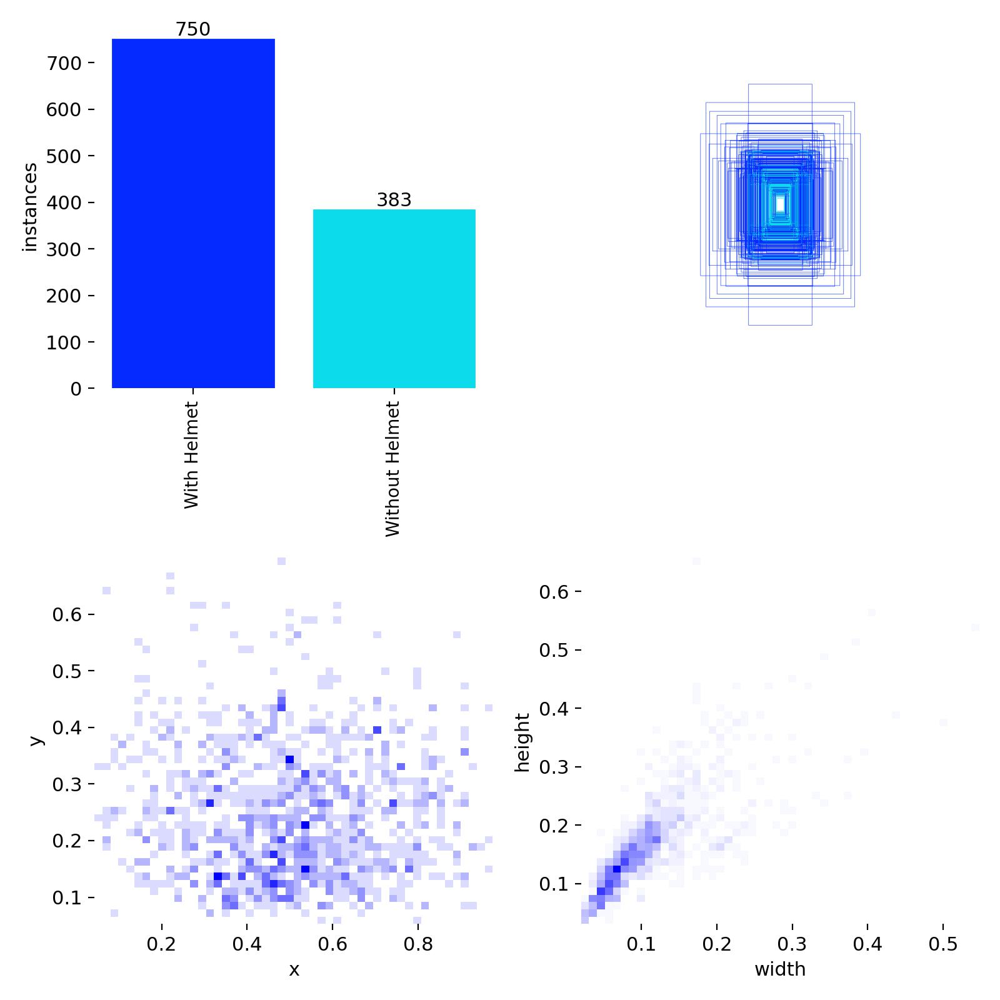
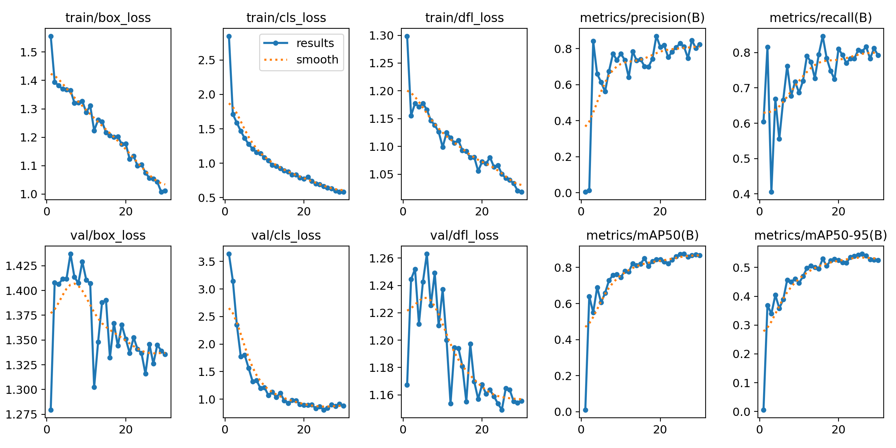
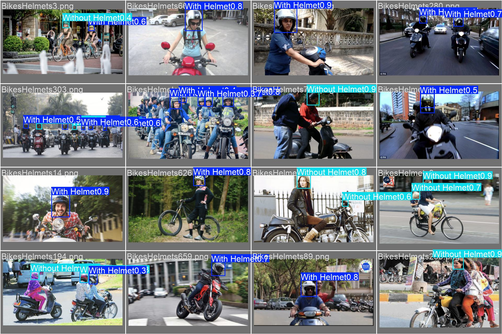

# 🪖 Real-Time Traffic Violation Detection System (YOLOv8, Supervision & FastAPI)

[](https://python.org)
[](https://pytorch.org)
[](https://ultralytics.com)
[](https://supervision.roboflow.com)
[](https://fastapi.tiangolo.com)

An end-to-end deep learning computer vision system designed to detect whether two-wheeler riders are wearing protective helmets (**`With Helmet`**) or committing a traffic safety violation (**`Without Helmet`**) in real time—complete with dataset engineering, YOLOv8n fine-tuning, head-to-head model benchmarking, and a full-stack **FastAPI** web dashboard.

---

## 📌 Table of Contents

- [Overview](#-overview)
- [System Architecture](#-system-architecture)
- [Dataset Engineering (`split_data.ipynb`)](#-dataset-engineering-split_dataipynb)
- [Experimental Results & Benchmarks](#-experimental-results--benchmarks)
- [Head-to-Head Model Comparison (`compare.ipynb`)](#-head-to-head-model-comparison-compareipynb)
- [Web Dashboard (`app.py`)](#-web-dashboard-apppy)
- [Repository File Structure](#-repository-file-structure)
- [Installation & Setup](#-installation--setup)
- [Notebook & Script Pipeline](#-notebook--script-pipeline)
- [Documentation & Presentation Assets](#-documentation--presentation-assets)
- [Troubleshooting & Windows Optimization](#-troubleshooting--windows-optimization)

---

## 📌 Overview

Riding two-wheelers without protective helmets is a leading cause of urban road fatalities. This project automates traffic safety monitoring and violation logging:

* **High-Accuracy Dual-Class Detection**: Distinguishes compliant riders (**`With Helmet`**, Green) from violators (**`Without Helmet`**, Red) across dense, multi-rider traffic scenes.
* **Rigorous Benchmarking**: Empirically compares our custom fine-tuned model (`saved_models/best.pt`) against an off-the-shelf pretrained model (`saved_models/helmet_detection_model.pt`) using direct ground-truth IoU matching and a 100-point decision matrix.
* **Full-Stack Web Dashboard (`app.py`)**: FastAPI application supporting static image uploads, sample galleries, remote image URLs, video uploads, live webcam frames, YouTube stream extraction (`yt-dlp`), runtime model hot-swapping, and CSV audit-history export.

---

## 🧠 System Architecture

```text
                       Traffic Image / Video / Webcam / YouTube Stream
                                             │
                                             ▼
                    ┌────────────────────────────────────────────────┐
                    │     YOLOv8n Object Detector (best.pt)          │
                    │     5.95 MB  |  3,011,238 Parameters           │
                    └────────────────────────┬───────────────────────┘
                                             │
                    ┌────────────────────────┴───────────────────────┐
                    │                                                │
                    ▼                                                ▼
          🟢 With Helmet (Safe)                      🚨 Without Helmet (Violation)
          - Class 0                                  - Class 1
          - Confidence Score                         - Confidence Score
          - Spatial Box [x1, y1, x2, y2]             - Spatial Box [x1, y1, x2, y2]
                    │                                                │
                    └────────────────────────┬───────────────────────┘
                                             │
                                             ▼
                          FastAPI Dashboard & Audit Engine (`app.py`):
                          - Color-Coded Bounding Box HUD & Live Counts
                          - Runtime Model Switcher (Custom vs Pretrained)
                          - Detection History & CSV Report Export
```

---

## 📂 Dataset Engineering (`split_data.ipynb`)

The raw dataset originates from **Pascal VOC XML** annotations and is transformed into normalized **YOLO** format via `supervision`:

1. **Raw Source (`data/`)**:
   * Total Images: **764** road images (`data/images/`)
   * Annotations: **764** Pascal VOC XML files (`data/annotations/`)
2. **YOLO Splits (`HelmetDataset/`)**:
   * **Train Split (80%)**: **611** images (`HelmetDataset/train/`)
   * **Validation Split (10%)**: **76** images (`HelmetDataset/val/`)
   * **Test Split (10%)**: **77** images (`HelmetDataset/test/`)
3. **Classes (`nc: 2`)**:
   * `0`: **`With Helmet`**
   * `1`: **`Without Helmet`**

Configuration (`HelmetDataset/data.yaml`):
```yaml
path: C:/.../HelmetDataset
train: train/images
val: val/images
test: test/images
nc: 2
names:
- With Helmet
- Without Helmet
```



---

## 📊 Experimental Results & Benchmarks

### 1. Training Telemetry (`train_model.ipynb` — 30 Epochs, GPU CUDA, `imgsz=640`, `batch=16`)
* **Peak Validation mAP@50 (Epoch 26):** **`87.54%`** | **mAP@50-95:** **`54.70%`**
* **Peak Validation Precision (Epoch 28):** **`84.73%`**
* **Total GPU Training Time (30 Epochs):** **`214.62 seconds`** (~3.6 minutes)



### 2. Unseen Test Set Evaluation (`test_model.ipynb` — `model.val(split='test')`)
Evaluated on **76 valid test images** (**136 ground-truth instances**; 1 corrupt label `BikesHelmets444.png` is automatically skipped by Ultralytics):

| Evaluation Split | Class | Images | Instances | Precision (P) | Recall (R) | F1-Score | mAP@50 | mAP@50-95 |
| :--- | :--- | :---: | :---: | :---: | :---: | :---: | :---: | :---: |
| **Test (Unseen)** | **All Classes** | **76** | **136** | **91.28%** | **90.14%** | **90.71%** | **94.90%** | **64.98%** |
| Test (Unseen) | `With Helmet` | 61 | 102 | 89.17% | **97.06%** | 92.94% | **97.48%** | 70.90% |
| Test (Unseen) | `Without Helmet` | 19 | 34 | **93.40%** | 83.23% | 88.02% | **92.32%** | 59.00% |

* **CPU Inference Speed (Intel Core i5-13420H):** `1.7 ms` preprocess + `44.6 ms` inference + `0.4 ms` postprocess (~21 FPS on CPU; >100 FPS on NVIDIA RTX GPU).



---

## 🥊 Head-to-Head Model Comparison (`compare.ipynb`)

`compare.ipynb` benchmarks **Model A (Custom Trained: `saved_models/best.pt`)** against **Model B (Pretrained: `saved_models/helmet_detection_model.pt`)** across **all 77 test images (139 ground-truth instances)** at `conf=0.25` and `IoU >= 0.50`:

| Metric | Model A: Custom (`best.pt`) | Model B: Pretrained (`helmet_detection_model.pt`) | Winner |
| :--- | :---: | :---: | :---: |
| **Model Size / Parameters** | `5.95 MB` / `3,011,238` | `5.96 MB` / `3,011,238` | Tie |
| **CPU Latency / Throughput** | **52.62 ms** (**19.0 FPS**) | 60.24 ms (16.6 FPS) | **Model A** |
| **Overall Precision** | 82.32% | **82.50%** | Model B |
| **Overall Recall** | **97.12%** (135 TP, 4 FN) | 94.96% (132 TP, 7 FN) | **Model A** |
| **Overall F1-Score** | **89.11%** | 88.29% | **Model A** |
| **Mean IoU (Box Overlap)** | 83.81% | **85.48%** | Model B |
| **`With Helmet` F1 (102 GT)** | 89.4% (P: 81.5%, R: 99.0%) | **90.4%** (P: 84.6%, R: 97.1%) | Model B |
| **`Without Helmet` F1 (37 GT)** | **88.3%** (P: 85.0%, R: 91.9%) | 82.5% (P: 76.7%, R: 89.2%) | **Model A (+5.8%)** |
| **100-Point Decision Matrix** | **65.0 / 100** | 35.0 / 100 | **Model A** 🏆 |

> **Key Insight:** While the pretrained model has slightly higher average confidence (`0.7439` vs. `0.7117` in `compre.py`), our custom fine-tuned model (`best.pt`) achieves **97.12% overall recall**, **43% fewer missed targets**, and a **+5.8% F1-score advantage** on the critical **`Without Helmet`** violator class.

---

## 🌐 Web Dashboard (`app.py`)

The project includes a full-stack **FastAPI** surveillance web application (`app.py`) powered by **Uvicorn**:

* **Multi-Source Inference**:
  * Upload static images (`POST /predict`) or select from built-in test samples (`POST /predict_sample`).
  * Analyze remote image URLs (`POST /predict_url`).
  * Process uploaded video files (`POST /predict_video_upload`).
  * Extract and detect frames from YouTube videos/streams via `yt-dlp` (`POST /predict_youtube`).
  * Real-time webcam frame detection (`POST /detect_webcam_frame`).
* **Runtime Model Switching**: Toggle seamlessly between `best.pt` and `helmet_detection_model.pt` via `/get_models` and `/switch_model`.
* **Audit Logging**: Inspect detection history (`/detection_history`), clear logs (`/clear_history`), or download records (`/export_history_csv`).

### Launch the Web Dashboard
```bash
python app.py
# Or using uvicorn directly:
uvicorn app:app --host 0.0.0.0 --port 8000 --reload
```
Then open `http://localhost:8000` in your browser.

---

## 📂 Repository File Structure

```text
Traffic-Violation-Detection-Deep-Learning/
│
├── saved_models/                         # Production model weights
│   ├── best.pt                           # Custom fine-tuned YOLOv8n model (5.95 MB)
│   └── helmet_detection_model.pt         # Pretrained comparison model (5.96 MB)
│
├── data/                                 # Raw Pascal VOC dataset (gitignored)
│   ├── images/                           # 764 original road images
│   └── annotations/                      # 764 Pascal VOC XML files
│
├── HelmetDataset/                        # Processed YOLO dataset splits (gitignored)
│   ├── train/                            # 611 training images & txt labels
│   ├── val/                              # 76 validation images & txt labels
│   ├── test/                             # 77 test images & txt labels
│   └── data.yaml                         # Ultralytics dataset configuration
│
├── runs/detect/                          # Training & validation artifacts (gitignored)
│   ├── train/                            # Loss curves, results.csv, args.yaml, weights
│   └── val*/                             # Confusion matrices, PR/F1 curves, batch preds
│
├── docs/                                 # Reports, presentation & visual assets
│   ├── assets/                           # Embedded charts & sample prediction images
│   ├── Helmet_Violation_Detection.pptx   # Project presentation slides
│   ├── Project report.md                 # Full written project report
│   ├── Project report.docx               # Word format report
│   └── Project Report .pdf               # PDF format report
│
├── split_data.ipynb                      # Step 1: VOC -> YOLO conversion & 80/10/10 split
├── train_model.ipynb                     # Step 2: YOLOv8n training & checkpoint export
├── test_model.ipynb                      # Step 3: Unseen test evaluation, metrics & plots
├── compare.ipynb                         # Step 4: 8-dimension benchmark & 100-pt scorecard
├── compre.py                             # Standalone CLI model comparison script
├── app.py                                # Step 5: FastAPI surveillance web dashboard
├── EXP.md                                # Deep-dive technical & mathematical reference
├── ppt.md                                # Slide-by-slide PPT content & speaker notes
├── requirements.txt                      # Python package dependencies
├── .gitignore                            # Git exclusion rules
└── README.md                             # Project documentation
```

---

## 🚀 Installation & Setup

### 1. Clone & Navigate to Repository
```bash
git clone https://github.com/NishantRajora/Traffic-Violation-Detection-Deep-Learning.git
cd Traffic-Violation-Detection-Deep-Learning
```

### 2. Install Dependencies
```bash
pip install -r requirements.txt
```

---

## 📓 Notebook & Script Pipeline

Run the workflow in order:

1. **`split_data.ipynb`**:
   * Reads Pascal VOC XMLs from `data/` using `supervision`.
   * Splits dataset into **Train (80%)**, **Validation (10%)**, and **Test (10%)**.
   * Exports normalized YOLO labels to `HelmetDataset/` and writes `HelmetDataset/data.yaml` using `.as_posix()` paths.
2. **`train_model.ipynb`**:
   * Configures CUDA device & Windows OpenMP flags.
   * Fine-tunes `yolov8n.pt` on `HelmetDataset/data.yaml` (`imgsz=640`, `batch=16`, early stopping `patience=10`).
   * Exports the best checkpoint to `saved_models/best.pt`.
3. **`test_model.ipynb`**:
   * Evaluates `saved_models/best.pt` on the unseen test split (`model.val(split='test')`).
   * Prints overall accuracy (`mAP@50`, `mAP@50-95`, Precision, Recall, F1), per-class breakdown, inference speed, and plots `confusion_matrix.png`, `BoxPR_curve.png`, and `BoxF1_curve.png`.
   * Displays a $3 \times 3$ visual inference grid on random test samples.
4. **`compare.ipynb` & `compre.py`**:
   * Benchmarks `best.pt` against `helmet_detection_model.pt` on latency, direct IoU matching, per-class enforcement metrics, and a 100-point decision matrix.
   * Run CLI comparison anytime via:
     ```bash
     python compre.py
     ```
5. **`app.py`**:
   * Launches the FastAPI web dashboard for real-time image, video, YouTube, and webcam inference.

---

## 📚 Documentation & Presentation Assets

* **[`EXP.md`](EXP.md)** — Detailed technical reference covering the data flow, mathematical definitions of all metrics (IoU, Precision, Recall, F1, mAP, CIoU/BCE/DFL losses), and full experimental results.
* **[`ppt.md`](ppt.md)** — Complete 16-slide presentation outline with speaker notes and image placement guides.
* **[`docs/Project report.md`](docs/Project%20report.md)** — Formal project report (also available as PDF and DOCX in `docs/`).
* **[`docs/Helmet_Violation_Detection.pptx`](docs/Helmet_Violation_Detection.pptx)** — PowerPoint presentation deck.

---

## 🔧 Troubleshooting & Windows Optimization

### OpenMP Duplicate Runtime Conflict (`libiomp5md.dll`)
On Windows environments with multiple OpenMP runtimes (e.g., PyTorch + Conda), `train_model.ipynb` includes:
```python
import os
os.environ["KMP_DUPLICATE_LIB_OK"] = "TRUE"
```

### Windows Backslash Path Errors in `data.yaml`
`split_data.ipynb` uses `FINAL_DIR.as_posix()` so `HelmetDataset/data.yaml` always uses forward slashes (`/`) and avoids Python string-escape errors.
