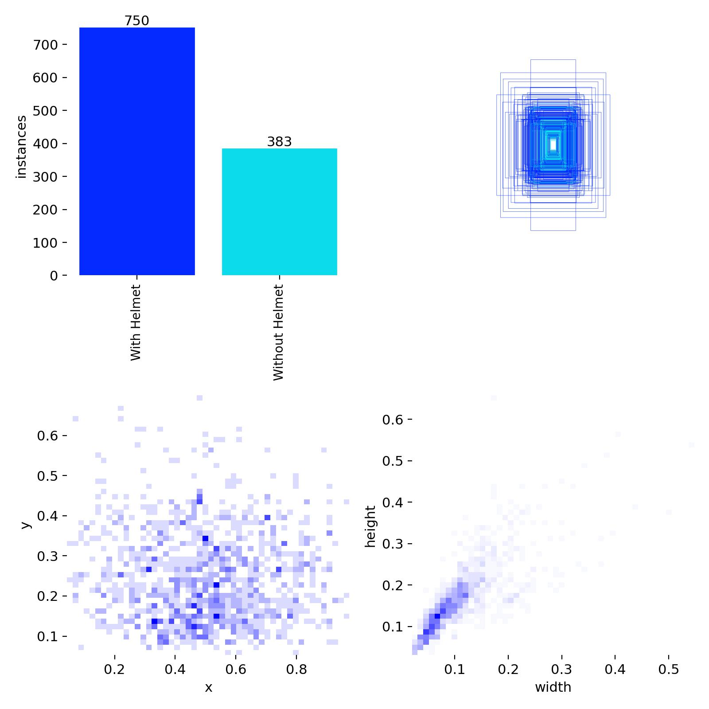
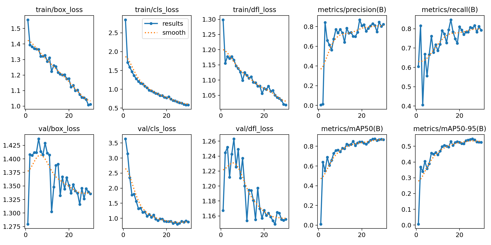
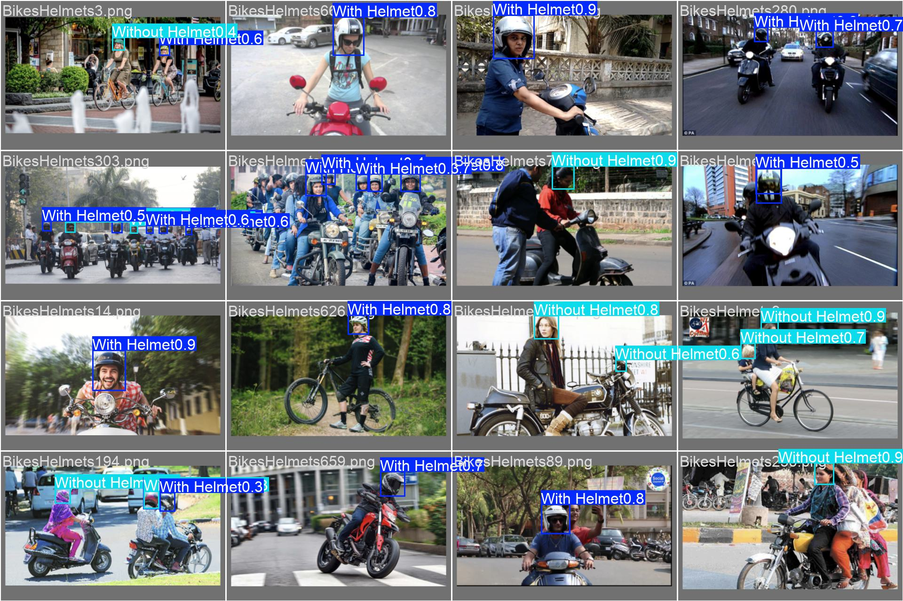

# Project Report

## Real-Time Helmet Compliance Detection for Two-Wheeler Traffic

**Project:** Traffic Violation Detection using Deep Learning  
**Primary model:** Fine-tuned YOLOv8n object detector  
**Dataset link supplied for this report:** [Helmet Detection dataset on Kaggle](https://www.kaggle.com/datasets/andrewmvd/helmet-detection)

> **Evidence and reproducibility note:** This report was prepared from the repository's current files, saved training artifacts, and notebook outputs. Where notebook outputs conflict with the current dataset or training artifacts, the conflict is identified rather than silently reconciled. The current split contains malformed bounding boxes; retrain and re-evaluate after cleaning them before treating the reported metrics as final.

## Table of Contents

- [Chapter 1: Introduction](#chapter-1-introduction)
  - [1.1 Background of the Project](#11-background-of-the-project)
  - [1.2 Problem Statement](#12-problem-statement)
  - [1.3 Motivation](#13-motivation)
  - [1.4 Objectives of the Project](#14-objectives-of-the-project)
- [Chapter 2: Literature Review](#chapter-2-literature-review)
- [Chapter 3: Dataset Description and Preprocessing](#chapter-3-dataset-description-and-preprocessing)
  - [3.1 Dataset Introduction](#31-dataset-introduction)
  - [3.2 Dataset Source and Collection](#32-dataset-source-and-collection)
  - [3.3 Dataset Attributes and Features](#33-dataset-attributes-and-features)
  - [3.4 Dataset Size and Distribution](#34-dataset-size-and-distribution)
  - [3.5 Exploratory Data Analysis](#35-exploratory-data-analysis)
  - [3.6 Handling Missing Values](#36-handling-missing-values)
  - [3.7 Handling Outliers and Invalid Annotations](#37-handling-outliers-and-invalid-annotations)
  - [3.8 Data Encoding and Transformation](#38-data-encoding-and-transformation)
  - [3.9 Feature Selection and Engineering](#39-feature-selection-and-engineering)
  - [3.10 Training, Validation, and Testing Split](#310-training-validation-and-testing-split)
- [Chapter 4: Methodology and Results](#chapter-4-methodology-and-results)
  - [4.1 Overview of the Proposed Methodology](#41-overview-of-the-proposed-methodology)
  - [4.2 Machine Learning and Deep Learning Used](#42-machine-learning-and-deep-learning-used)
  - [4.3 Model Architecture](#43-model-architecture)
  - [4.4 Hyperparameter Selection and Tuning](#44-hyperparameter-selection-and-tuning)
  - [4.5 Evaluation Metrics](#45-evaluation-metrics)
  - [4.6 Comparative Analysis of Models](#46-comparative-analysis-of-models)
  - [4.7 Result Visualization](#47-result-visualization)
  - [4.8 Discussion and Interpretation of Results](#48-discussion-and-interpretation-of-results)
- [Chapter 5: Conclusion and Future Scope](#chapter-5-conclusion-and-future-scope)
  - [5.1 Summary of the Project](#51-summary-of-the-project)
  - [5.2 Contributions of the Project](#52-contributions-of-the-project)
  - [5.3 Limitations](#53-limitations)
  - [5.4 Future Enhancements](#54-future-enhancements)
- [Chapter 6: References and Appendices](#chapter-6-references-and-appendices)
  - [6.1 References](#61-references)
  - [6.2 Appendix A: Python Code](#62-appendix-a-python-code)
  - [6.3 Appendix B: Publications](#63-appendix-b-publications)

## Chapter 1: Introduction

### 1.1 Background of the Project

Two-wheeler traffic scenes contain riders at different scales, viewing angles, and levels of occlusion. Manually inspecting every frame from a traffic camera is resource-intensive. Object detection provides a way to locate relevant objects in an image and assign a class to each detected object.

This project applies a YOLOv8 object detector to classify annotated rider/head regions as **With Helmet** or **Without Helmet**. It includes a dataset conversion and training workflow, evaluation notebooks, a model comparison notebook, and a FastAPI application for running detections on images and selected video frames.

### 1.2 Problem Statement

The project addresses the task of identifying helmet-status objects in traffic images and returning their locations and classes. The practical challenge is to detect both classes under varied image conditions while limiting missed detections and false alarms. The implementation is a detection aid; it does not itself verify a rider's identity, read a license plate, or issue a legally valid citation.

### 1.3 Motivation

- Improve the speed and consistency of reviewing traffic imagery.
- Highlight possible non-compliance for follow-up by a human operator.
- Use a compact model suitable for experimentation on modest computing hardware.
- Provide visual evidence through bounding boxes, labels, and confidence values.

### 1.4 Objectives of the Project

1. Convert Pascal VOC XML annotations into YOLO-format labels.
2. Organize the images into training, validation, and test splits.
3. Fine-tune a pretrained YOLOv8n detector for two helmet-status classes.
4. Evaluate detection quality using precision, recall, and mean average precision.
5. Compare the custom checkpoint with a second stored helmet detector.
6. Expose inference through a FastAPI dashboard and API endpoints.
7. Document data-quality and evaluation limitations that affect reproducibility.

## Chapter 2: Literature Review

Object detection combines localization and classification: unlike image classification, the model must also estimate a bounding box for each object. The Pascal VOC dataset format represents an object using XML metadata and pixel-coordinate bounding boxes [2]. The repository's raw annotations follow this general structure.

YOLO introduced a single-stage approach that predicts object classes and box locations in one network pass [3]. This project uses Ultralytics' YOLOv8n implementation, initialized from `yolov8n.pt` and fine-tuned on the project dataset [4]. The nano variant is intended as a relatively compact member of the YOLO model family. The project uses it for two-class detection rather than general-purpose traffic-scene understanding.

The preprocessing notebook uses the Supervision library to load Pascal VOC data and export YOLO labels [5]. The evaluation notebooks use two different protocols: Ultralytics validation, which produces precision-recall and mAP metrics across confidence thresholds, and a project-written fixed-threshold comparison based on class-aware IoU matching. These metrics answer different questions and must not be compared as if they were the same experiment.

This implementation focuses only on helmet-status detection. It does not implement license-plate recognition, rider tracking across frames, or an end-to-end automated enforcement process.

| Approach | Relevance to this project | Trade-off |
|---|---|---|
| Manual frame review | Human observers inspect traffic images or video | Can interpret context, but does not scale well and may be slow or inconsistent |
| Image classification | Assigns a label to a whole image | Simpler output, but does not locate multiple riders in one scene |
| Two-stage object detection | Generates candidate regions before classification | Can be accurate, but often requires more computational work |
| Single-stage YOLO detection | Predicts boxes and classes in one detector | Suits fast inference and multiple objects, but still depends on good labels and representative data |

The project selects the last approach because images can contain multiple labeled riders and the output needs spatial boxes for the dashboard. This choice is an engineering trade-off, not evidence that a single-stage model is universally superior.

## Chapter 3: Dataset Description and Preprocessing

### 3.1 Dataset Introduction

The project uses images of two-wheeler traffic with annotations for **With Helmet** and **Without Helmet**. The repository contains a raw image/annotation collection and a processed YOLO dataset. Raw images are PNG files; annotations are Pascal VOC XML files. The processed dataset contains one YOLO text label file per image.

### 3.2 Dataset Source and Collection

The project identifies the [Kaggle Helmet Detection dataset](https://www.kaggle.com/datasets/andrewmvd/helmet-detection) as its dataset source. The repository contains 764 local image files and 764 XML annotation files under `data/images/` and `data/annotations/`. The source does not document a separate collection protocol, capture dates, geographic sampling method, or image-level provenance; those details are therefore not asserted here.

### 3.3 Dataset Attributes and Features

| Attribute | Description |
|---|---|
| Image | Traffic scene stored as PNG |
| Raw annotation | Pascal VOC XML with image size, object class, and bounding-box coordinates |
| Processed annotation | One row per object: class ID, normalized center x/y, normalized width/height |
| Class 0 | With Helmet |
| Class 1 | Without Helmet |
| Detection output | Class, confidence score, and predicted bounding box |

Image dimensions are not uniform. The XML records commonly show widths of 400 pixels and varying heights; images may also be portrait-oriented or otherwise differently sized. YOLO training therefore consumes resized/letterboxed images rather than relying on a single source resolution.

### 3.4 Dataset Size and Distribution

The local raw dataset contains **764 images**, **764 XML files**, and **1,451 annotated objects**. The class totals below are counted from the current YOLO label files, including the 17 rows with invalid, non-normalized coordinates described in Section 3.7.

| Split | Images | With Helmet boxes | Without Helmet boxes | Total boxes |
|---|---:|---:|---:|---:|
| Train | 611 | 770 | 399 | 1,169 |
| Validation | 76 | 90 | 53 | 143 |
| Test | 77 | 102 | 37 | 139 |
| **Total** | **764** | **962** | **489** | **1,451** |

Across all annotations, With Helmet accounts for approximately 66.3% of boxes and Without Helmet for 33.7%. The dataset is therefore imbalanced, with about twice as many With Helmet objects. These counts describe the current files, not a cleaned dataset.

### 3.5 Exploratory Data Analysis

The repository includes an Ultralytics label-distribution plot and training telemetry. The label plot summarizes class and box-coordinate patterns. The training figures show the progression of losses and validation metrics over the recorded run.



*Figure 1. Dataset label and box distribution from the saved training run.*

The principal EDA findings from the current files are:

- The dataset has two classes and 1,451 annotation rows.
- Class distribution favors With Helmet (962 boxes) over Without Helmet (489 boxes).
- There are three images with empty labels, consistent with the three XML files containing no objects.
- The raw XML files parse successfully, but some bounding-box values are implausible for their corresponding image dimensions and have propagated into YOLO labels.

The number of annotated objects per raw image is also uneven. The current XML inventory has 425 images with one object, 173 with two, 72 with three, 40 with four, 28 with five, 10 with six, seven with seven, two each with eight and nine, one with ten, one with eleven, and three with no objects. This distribution means that a large portion of the dataset consists of relatively sparse scenes, while only a small number of images provide dense multi-object examples.

| Objects in image | Number of images |
|---:|---:|
| 0 | 3 |
| 1 | 425 |
| 2 | 173 |
| 3 | 72 |
| 4 | 40 |
| 5 | 28 |
| 6 | 10 |
| 7 | 7 |
| 8 | 2 |
| 9 | 2 |
| 10 | 1 |
| 11 | 1 |

### 3.6 Handling Missing Values

All 764 local images have a corresponding XML annotation, and all 764 processed images have a corresponding label file. No missing label files were found in the current split. Three label files are empty because their corresponding XML records contain no objects. The project does not impute missing coordinates or synthesize labels; empty-label images are retained.

### 3.7 Handling Outliers and Invalid Annotations

The current YOLO text files contain **17 invalid box rows across 15 images**: 14 rows in training, two in validation, and one in testing. These rows have coordinate values outside the expected normalized range of 0 to 1. For example, `BikesHelmets444.txt` contains `1 298.99750 47.99686 78.00500 80.00629`. Its source XML has image dimensions 200 × 159, but the corresponding raw XML box includes `xmin=52000` and `xmax=67600`. Such values indicate malformed source annotation coordinates, not ordinary visual outliers.

| Split | Invalid box rows | Affected images | Example |
|---|---:|---:|---|
| Train | 14 | 12 | `BikesHelmets103.xml` has `xmin=149282` for a 400-pixel-wide image |
| Validation | 2 | 2 | Invalid coordinates occur in `BikesHelmets441` and `BikesHelmets706` |
| Test | 1 | 1 | `BikesHelmets444.xml` has `xmin=52000` for a 200-pixel-wide image |
| **Total** | **17** | **15** | Raw pixel-scale values were exported as if already normalized |

The current preprocessing/exported files do not correct or filter these rows. The saved `test_model.ipynb` output reports 76 images and 136 objects, while the current test split contains 77 images and 139 label rows. This difference is consistent with the notebook's accompanying note that a corrupt annotation was skipped, but it means the saved test metrics are not a clean, directly reproducible evaluation of all current files.

**Recommended correction before a final experiment:** validate every source box against image dimensions, repair it from the image/source annotation if possible, otherwise remove the invalid object or exclude the affected image with a documented reason. Then regenerate all splits and labels, retrain, and rerun both evaluation protocols. Do not silently clamp coordinates: that would invent box locations.

### 3.8 Data Encoding and Transformation

`split_data.ipynb` loads the images and XML annotations with `supervision.DetectionDataset.from_pascal_voc`, splits the dataset, and exports each split using `as_yolo`. YOLO labels encode each box as:

`class_id x_center y_center width height`

For an original image of width \(W\) and height \(H\), a Pascal VOC box \([x_{\min},y_{\min},x_{\max},y_{\max}]\) is represented in YOLO form as:

\[
x_c = \frac{x_{\min}+x_{\max}}{2W}, \quad
y_c = \frac{y_{\min}+y_{\max}}{2H}, \quad
w = \frac{x_{\max}-x_{\min}}{W}, \quad
h = \frac{y_{\max}-y_{\min}}{H}.
\]

The class ID is an integer; the remaining four values should be normalized to the range [0, 1]. The dataset configuration in `HelmetDataset/data.yaml` specifies the train, validation, and test image directories, two classes, and their names. The invalid rows described above violate the expected normalization and must be fixed in the source data pipeline.

### 3.9 Feature Selection and Engineering

No tabular feature-selection step is used. The model learns visual features directly from image pixels. The only task-specific target engineering is mapping the two class names to numeric IDs and converting bounding-box coordinates from Pascal VOC to YOLO representation. Training configuration records common image augmentations, including mosaic, horizontal flip, scale, HSV variation, and translation.

### 3.10 Training, Validation, and Testing Split

The split notebook records **611 training images (80%)**, **76 validation images (10%)**, and **77 test images (10%)**. These splits are stored in separate directories under `HelmetDataset/`. The notebook source does not explicitly set a split seed, so exact membership should be treated as the saved split rather than assumed to be reproducible from a fresh run.

The split is by image rather than by individual object. This is the appropriate unit for preventing boxes from the same image from appearing in multiple subsets. However, the saved notebooks do not document whether near-duplicate frames or related scenes were checked across splits. Such a check would be useful before claiming that the test set represents fully independent camera scenes.

## Chapter 4: Methodology and Results

### 4.1 Overview of the Proposed Methodology

1. Load paired images and Pascal VOC annotations.
2. Split the dataset into train, validation, and test subsets.
3. Export YOLO labels and configure class names in `data.yaml`.
4. Fine-tune a pretrained YOLOv8n model on the training split.
5. Select the best checkpoint using validation performance.
6. Evaluate using Ultralytics validation and a separate fixed-threshold model-comparison routine.
7. Use the FastAPI application to run inference and display annotated results.

At inference time, an image is decoded into a color array, passed to the active model with a confidence threshold and IoU threshold, and the returned boxes are mapped to dashboard labels. For saved image/video requests, the API returns class counts, a compliance percentage, inference latency, and an annotated image. The webcam endpoint accepts a browser-provided frame and returns an annotated frame and counts.

```text
Raw images + Pascal VOC XML
            |
            v
Supervision import -> image-level splits -> YOLO labels + data.yaml
            |
            v
Pretrained YOLOv8n -> fine-tuning -> best checkpoint
            |
            +--> Ultralytics validation and saved plots
            +--> Fixed-threshold comparison against second checkpoint
            |
            v
FastAPI inference UI/API -> boxes, classes, counts, session history
```

### 4.2 Machine Learning and Deep Learning Used

The task is supervised object detection. The implementation uses Ultralytics YOLOv8n, PyTorch, OpenCV, and Supervision. The detector predicts bounding boxes, class labels, and confidence scores. The two target classes are With Helmet and Without Helmet.

### 4.3 Model Architecture

The project initializes the detector from `yolov8n.pt` and fine-tunes it for two classes. It uses the Ultralytics detection implementation and stores model weights in `saved_models/` and `runs/detect/train/weights/`. This report does not infer a layer-by-layer network specification beyond the model variant declared in the training artifacts.

At a conceptual level, an object detector extracts visual representations from the image, combines information at multiple spatial scales, and predicts class scores and box coordinates. Fine-tuning starts from pretrained weights so the detector does not have to learn all generic visual features from this relatively small local dataset. The precise module configuration is owned by the installed Ultralytics model definition and checkpoint; no architecture summary is reverse-engineered from the weight file here.

The FastAPI application loads a local checkpoint, runs inference on an image/frame, maps model labels into safe/violation display categories, and returns counts and annotated imagery. A model registry supports switching between available local weights.

### 4.4 Hyperparameter Selection and Tuning

The saved `runs/detect/train/args.yaml` is the record of the completed run and takes precedence over the current notebook template where values differ.

| Parameter | Recorded run setting |
|---|---:|
| Model initialization | `yolov8n.pt` |
| Epochs completed | 30 |
| Image size | 640 |
| Batch size | 16 |
| Device | `0` (GPU device identifier in the run configuration) |
| Optimizer | `auto` |
| Initial learning rate (`lr0`) | 0.01 |
| Final learning-rate factor (`lrf`) | 0.01 |
| Weight decay | 0.0005 |
| Warmup epochs | 3 |
| Mosaic | 1.0; closed for final 10 epochs |
| Horizontal flip | 0.5 |
| Seed / deterministic | 0 / enabled |

The notebook source currently describes a 50-epoch run with `patience=10`, whereas the saved run arguments show 30 epochs and `patience=100`. The saved `results.csv` contains 30 epochs. The results below therefore describe the saved 30-epoch run, not the current notebook template.

The recorded telemetry shows the following representative checkpoints:

| Epoch | Precision | Recall | mAP@50 | mAP@50–95 | Train box loss | Train class loss | Train DFL loss |
|---:|---:|---:|---:|---:|---:|---:|---:|
| 1 | 0.42% | 60.44% | 1.09% | 0.61% | 1.556 | 2.850 | 1.299 |
| 16 | 70.21% | 84.66% | 85.16% | 52.97% | 1.207 | 0.876 | 1.091 |
| 26 (best mAP) | 81.20% | 80.28% | **87.54%** | **54.70%** | 1.057 | 0.640 | 1.043 |
| 30 (final) | 82.47% | 79.25% | 86.68% | 52.51% | 1.011 | 0.583 | 1.018 |

The best mAP epoch is not the same as the best precision or the final epoch. The best validation checkpoint should therefore be selected using the intended target metric and then evaluated once on a clean held-out test set. The CSV's final elapsed time is approximately 214.6 seconds; the saved run arguments identify device `0` but do not reliably document the exact GPU model.

### 4.5 Evaluation Metrics

- **Precision:** proportion of predicted boxes that match a ground-truth object.
- **Recall:** proportion of ground-truth objects that are detected.
- **F1-score:** harmonic mean of precision and recall.
- **IoU:** intersection area divided by union area for a predicted and ground-truth box.
- **AP / mAP@50:** area under the precision-recall curve at IoU 0.50, averaged across classes.
- **mAP@50–95:** mean AP over IoU thresholds 0.50 through 0.95.
- **Mean IoU:** average IoU of the matched detections in the direct comparison routine.

For one class, precision \(P\), recall \(R\), and F1 are:

\[
P = \frac{TP}{TP+FP}, \quad
R = \frac{TP}{TP+FN}, \quad
F_1 = \frac{2PR}{P+R}.
\]

Here, \(TP\) is a correctly classified box matched to a ground-truth box, \(FP\) is an unmatched or incorrectly classified prediction, and \(FN\) is a ground-truth box without a matching prediction. IoU is \(area(B_p \cap B_g)/area(B_p \cup B_g)\). In the direct comparison, a match must have the same class and IoU of at least 0.50. Ultralytics mAP summarizes precision-recall behavior across confidence thresholds; it is not the same as the fixed-confidence precision/recall values printed by the comparison notebook.

The mAP values are object-detection metrics, not classification accuracy. mAP is the technically appropriate term for the notebook's reported detection score.

### 4.6 Comparative Analysis of Models

The repository's `compare.ipynb` compares the custom checkpoint (`best.pt`) with `helmet_detection_model.pt`. Its saved output uses a fixed confidence threshold of 0.25 and class-aware greedy matching at IoU 0.50 on 77 images and 139 ground-truth rows.

| Metric | Custom trained | Stored pretrained model |
|---|---:|---:|
| Precision | 82.32% | 82.50% |
| Recall | **97.12%** | 94.96% |
| F1-score | **89.11%** | 88.29% |
| Mean IoU | 83.81% | **85.48%** |
| True positives | 135 | 132 |
| False positives | 29 | **28** |
| False negatives | **4** | 7 |
| Recorded CPU latency | **52.62 ms** | 60.24 ms |

The comparison notebook reports a 100-point, criterion-based score of 65 for the custom model and 35 for the stored pretrained model. This is the notebook's chosen scoring rubric, not a standard benchmark metric. Its direct comparison includes the current test label rows, including the invalid `BikesHelmets444` box, so it should be rerun after data cleaning.

The saved comparison notes also report this per-class breakdown:

| Class | Ground-truth boxes | Custom P / R / F1 | Stored model P / R / F1 |
|---|---:|---:|---:|
| With Helmet | 102 | 81.5% / 99.0% / 89.4% | 84.6% / 97.1% / 90.4% |
| Without Helmet | 37 | 85.0% / 91.9% / 88.3% | 76.7% / 89.2% / 82.5% |

This table should be read as a saved notebook result and not assumed to be a fresh evaluation. The direct evaluator is a custom greedy matching routine, and its outcomes depend on the confidence and IoU thresholds, the exact label files, and the order in which predictions are matched. The comparison's CPU latency figures likewise describe a particular saved benchmark run; they are not a guarantee of application throughput on another machine.

The saved `test_model.ipynb` output reports a separate Ultralytics evaluation: 76 images, 136 objects, precision 91.28%, recall 90.14%, mAP@50 94.90%, and mAP@50–95 64.98%. Its class-level output reports mAP@50 values of 97.48% for With Helmet and 92.32% for Without Helmet. These results use a different evaluation protocol and a different effective test set than the 77-image direct comparison. They are preserved here as historical notebook output, not presented as independently reproduced metrics.

| Class (saved notebook output) | Images | Objects | Precision | Recall | F1-score | mAP@50 | mAP@50–95 |
|---|---:|---:|---:|---:|---:|---:|---:|
| With Helmet | 61 | 102 | 89.17% | 97.06% | 92.94% | 97.48% | 70.9% |
| Without Helmet | 19 | 34 | 93.40% | 83.23% | 88.02% | 92.32% | 59.0% |

### 4.7 Result Visualization

The following figures are copies of saved training-run artifacts included with this report.



*Figure 2. Saved 30-epoch training telemetry. The run's best mAP@50 was 87.54% at epoch 26; best mAP@50–95 was 54.70% at epoch 26.*



*Figure 3. Example validation-batch predictions from the saved training run. These visualizations are qualitative and do not replace test-set evaluation.*

### 4.8 Discussion and Interpretation of Results

The saved training telemetry shows improvement from an mAP@50 of 1.09% in epoch 1 to 87.54% at epoch 26, with the final epoch recording 86.68%. Training box, classification, and distribution focal losses also decrease over the 30 epochs. The gap between the best validation result and the final result reinforces the importance of selecting the saved best checkpoint rather than assuming the final epoch is best.

The two historical test summaries must not be combined: the Ultralytics notebook output and direct fixed-threshold comparison use different protocols and different object counts. More importantly, the current dataset contains 17 invalid coordinate rows, and the direct comparison includes the invalid test row. Metrics should be treated as provisional until annotations are cleaned and both evaluations are rerun on the same documented split.

The recorded comparison suggests the custom model has higher recall and lower latency in that run, while the stored pretrained model has slightly higher precision and mean IoU. In a safety-review workflow, recall can help reduce missed potential violations, but false positives still require human review. Neither model's score alone establishes fitness for automated enforcement.

The application exposes the following main routes:

| Route | Purpose |
|---|---|
| `GET /` | Serve the dashboard interface |
| `GET /system_info` | Return active model and device metadata |
| `GET /get_models`, `POST /switch_model` | List local models and switch the active checkpoint |
| `GET /sample_images`, `POST /predict_sample` | Browse and analyze repository sample images |
| `POST /predict` | Analyze an uploaded image |
| `POST /predict_url` | Download and analyze a remote image |
| `POST /predict_video_upload` | Extract and analyze a selected timestamp from an uploaded video |
| `POST /predict_youtube` | Extract and analyze a selected timestamp from a YouTube video |
| `POST /detect_webcam_frame` | Analyze a browser-submitted webcam frame |
| `GET /detection_history`, `POST /clear_history`, `GET /export_history_csv` | View, clear, and export in-memory session history |

The image URL and YouTube endpoints retrieve remote resources, and uploaded files are decoded by the application. This report describes the implemented functionality, not a production security or privacy assessment. Before public deployment, these routes should be reviewed for input size limits, URL restrictions, authentication, rate limiting, and safe retention of uploaded imagery.

## Chapter 5: Conclusion and Future Scope

### 5.1 Summary of the Project

The project implements a complete prototype workflow for helmet-status object detection: Pascal VOC data preparation, YOLOv8n training, saved-checkpoint evaluation, a two-model comparison, and a FastAPI inference interface. The available training artifacts show a best validation mAP@50 of 87.54% and mAP@50–95 of 54.70% during the saved 30-epoch run. Historical test outputs are documented with their protocol and data-count limitations.

### 5.2 Contributions of the Project

- A repeatable notebook-based conversion and training workflow.
- A two-class YOLO detector and saved weights.
- Training and validation plots, dataset split labels, and evaluation notebooks.
- A FastAPI interface supporting image uploads, sample images, image URLs, selected video frames, YouTube frames, and browser webcam frames.
- A model switcher and in-memory detection history with CSV export.
- Identification of label corruption and conflicts between saved evaluation outputs and current data.

### 5.3 Limitations

- **Annotation quality:** 17 box rows currently violate YOLO normalization expectations.
- **Metric reproducibility:** saved test outputs and direct-comparison outputs use different image/object counts and protocols.
- **Documentation drift:** some repository documentation describes different split paths, epoch counts, and metrics than the current configuration and saved artifacts. This report prioritizes the current files and clearly marks legacy results.
- **Dataset scope:** the model predicts helmet-status labels only; it does not identify a rider or vehicle.
- **Operational evaluation:** the repository does not establish accuracy across camera locations, weather, lighting, or demographic groups.
- **Video workflow:** the video-upload and YouTube endpoints analyze a selected frame/timestamp; the existence of a webcam-frame endpoint does not by itself establish sustained real-time throughput.
- **Audit persistence:** the application stores detection history in process memory, so history is not durable across restarts.
- **Human oversight:** detections should be reviewed by a person before any consequential action.

### 5.4 Future Enhancements

1. Correct or exclude malformed source boxes, add validation checks to the conversion pipeline, and regenerate the splits.
2. Re-run training and both evaluation protocols with a fixed split seed and a clean, held-out test set.
3. Record environment versions, device model, inference settings, and test results in versioned experiment metadata.
4. Add per-class error analysis and evaluate across additional locations, lighting conditions, occlusion levels, and camera angles.
5. Add multi-frame tracking and true video-stream processing with measured end-to-end latency.
6. Consider license-plate detection only as a separate, privacy-reviewed extension.
7. Replace in-memory event history with controlled, durable storage and add access control before deployment.
8. Retain human review and a documented appeals process for any operational use.
9. Add automated data checks for XML/image dimension consistency, normalized box bounds, valid class IDs, duplicate files, and empty annotations.
10. Report confidence intervals or repeated runs where appropriate, and maintain a fixed, untouched test set for model selection and comparison.

## Chapter 6: References and Appendices

### 6.1 References

[1] AndrewMVD, “Helmet Detection,” *Kaggle*. [Online]. Available: https://www.kaggle.com/datasets/andrewmvd/helmet-detection. Dataset URL supplied for this project.

[2] M. Everingham, L. Van Gool, C. K. I. Williams, J. Winn, and A. Zisserman, “The Pascal Visual Object Classes (VOC) Challenge,” *International Journal of Computer Vision*, vol. 88, pp. 303–338, 2010.

[3] J. Redmon, S. Divvala, R. Girshick, and A. Farhadi, “You Only Look Once: Unified, Real-Time Object Detection,” in *Proc. IEEE Conference on Computer Vision and Pattern Recognition (CVPR)*, 2016, pp. 779–788.

[4] Ultralytics, “YOLOv8,” *Ultralytics Documentation*. [Online]. Available: https://docs.ultralytics.com/models/yolov8/.

[5] Roboflow, “Supervision,” *Supervision Documentation*. [Online]. Available: https://supervision.roboflow.com/.

### 6.2 Appendix A: Python Code

The full project implementation is maintained in the repository rather than duplicated in this report:

- `split_data.ipynb` — loads Pascal VOC annotations, creates splits, exports YOLO labels, and writes the dataset configuration.
- `train_model.ipynb` — defines the YOLO training workflow.
- `test_model.ipynb` — runs Ultralytics validation and visual inference.
- `compare.ipynb` and `compre.py` — compare the stored custom and pretrained models.
- `app.py` — FastAPI application and inference pipeline.

Representative inference call used by the application:

```python
from ultralytics import YOLO

model = YOLO("saved_models/best.pt")
results = model.predict(
    image,
    conf=0.25,
    iou=0.45,
    verbose=False,
)
```

The call above is a compact illustration of the application's model invocation. In `app.py`, the active model is selected from local checkpoints and inference also passes the selected device and user-configurable confidence/IoU settings. The training, conversion, and comparison code remains in the referenced notebooks and script.

### 6.3 Appendix B: Publications

No project-authored publication or publication record is included in the repository.
